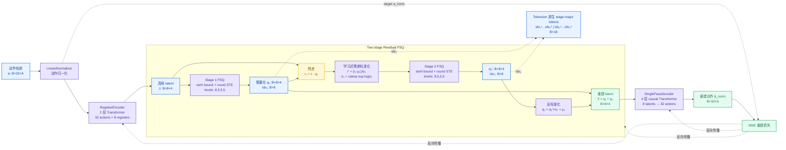
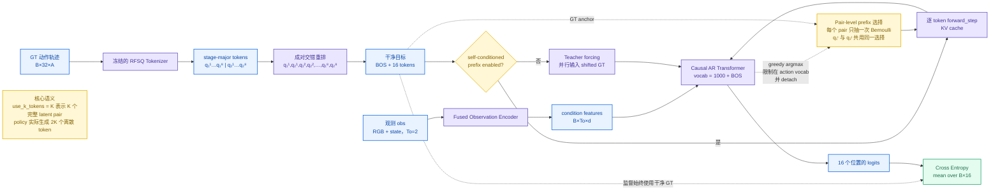
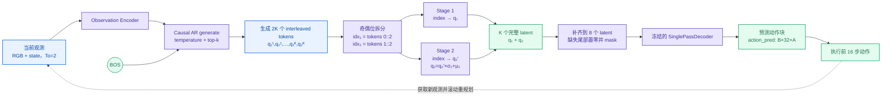

# 当前 RFSQ 方法数据流

> 当前配置：动作长度 `32`，latent registers `H=8`，latent 维度 `D=4`，两级 FSQ 的 `levels=[8,5,5,5]`，每级 codebook 大小为 `1000`。

## 1. RFSQ Action Tokenizer

Tokenizer 的两个 stage 各自产生 8 个 token。它们使用相同大小的离散词表，但 FSQ 模块参数不共享。`μ₂` 和 `logσ₂` 是可学习参数。

## 2. Pair-aware Policy 训练

Pair-aware self-conditioning 的关键点是：同一个 Bernoulli 决策同时控制一对 `(q₁ᶦ,q₂ᶦ)` 的 prefix 来源，因此不会出现“半对使用预测、半对使用 GT”的情况。无论 prefix 如何混合，交叉熵目标始终是干净的 interleaved GT token。

## 3. Policy 推理与动作执行

## 对应代码

- `oat/tokenizer/oat/quantizer/rfsq.py`：两阶段 residual FSQ。
- `oat/tokenizer/oat/tokenizer.py`：动作归一化、编码、量化、解码。
- `oat/policy/oatpolicy_rfsq_pair.py`：stage-major/interleaved 转换、pair-aware 训练与推理。
- `oat/policy/self_conditioned_prefix.py`：self-conditioned prefix 配置和概率调度。

> 注意：self-conditioned 分支只有在 `self_conditioned_prefix.enabled: true` 时启用；否则走普通 teacher forcing。
